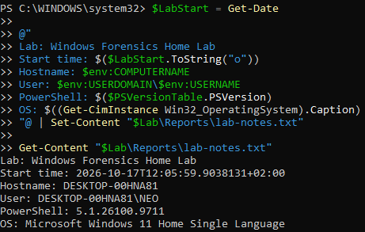
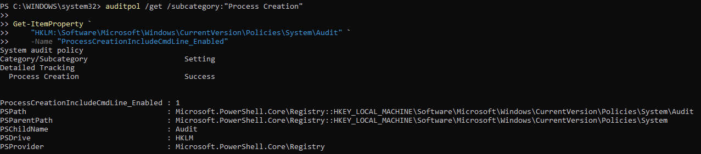
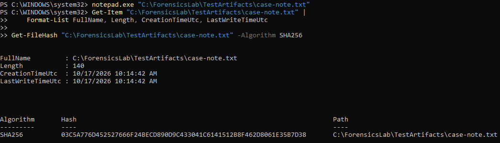
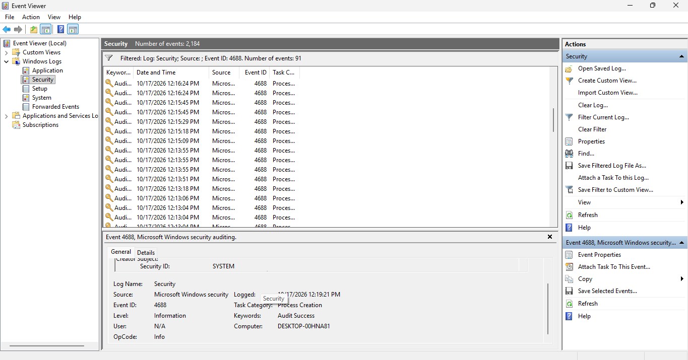
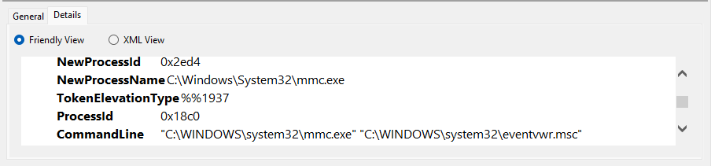
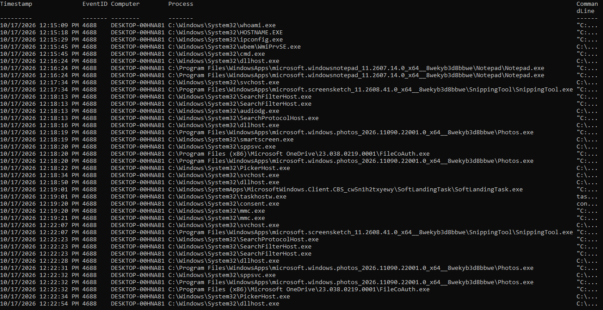
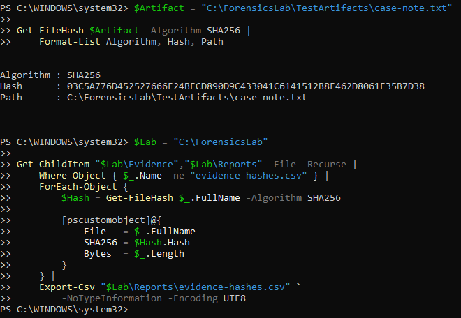
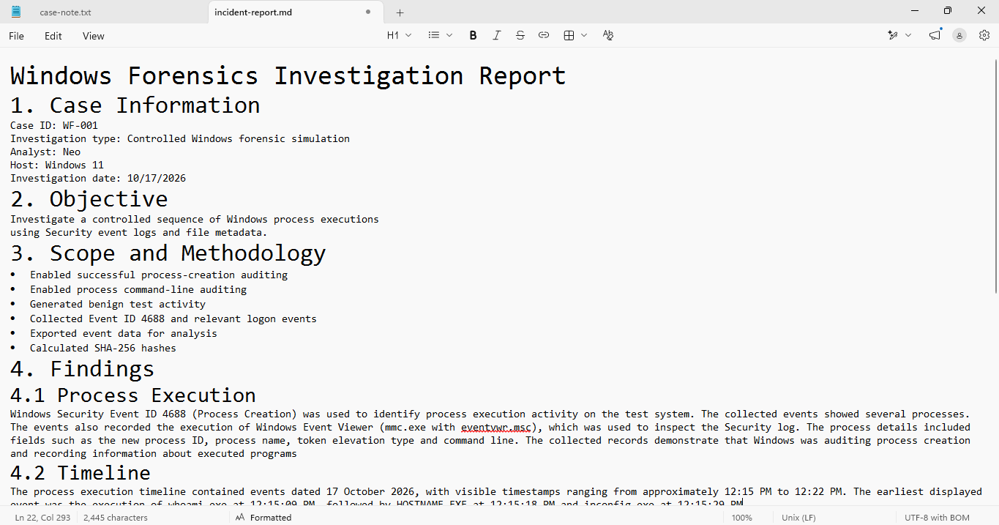

# Windows Forensics Home Lab

## 1. Summary

This project demonstrates a practical Windows forensics workflow using native Windows security auditing, PowerShell, and Event Viewer

The lab focuses on collecting and analysing Windows Security event logs, investigating process creation events, reconstructing a process execution timeline, examining file metadata, and calculating SHA-256 hashes to support evidence integrity verification

A controlled test scenario was used to generate benign system activity and a known test artifact. The resulting evidence was intended to demonstrate how an analyst can correlate recorded events with known actions and document findings in a structured investigation report

**Project type:** Windows Forensics / Blue Team / Security Operations  
**Environment:** Windows 11  
**Primary tools:** Windows Event Viewer, PowerShell, Windows Security auditing  
**Case reference:** WF-001

## 2. Objectives

The objectives of this lab were to:

- Configure Windows process creation auditing
- Enable process command-line logging
- Generate controlled and benign process execution activity
- Investigate Windows Security Event ID 4688
- Examine relevant logon events, including Event IDs 4624 and 4625
- Export event records into CSV and XML formats
- Build a chronological process execution timeline
- Examine file metadata and calculate SHA-256 hashes
- Document findings, evidence limitations, and investigation conclusions

## 3. Lab Environment

The investigation used a Windows workstation with administrative access

| Component | Description |
|---|---|
| Operating system | Windows 11 |
| Shell | Windows PowerShell |
| Log source | Windows Security event log |
| Primary event | Event ID 4688 — Process Creation |
| Contextual events | Event IDs 4624 and 4625 — Logon events |
| Evidence formats | CSV and XML |
| Integrity algorithm | SHA-256 |

The exact operating system version, hostname, PowerShell version, and collection timestamps should be taken from the actual lab environment and investigation notes

## 4. Tools and Technologies

### Windows Event Viewer

Used to inspect the Security event log, filter process creation events, and examine individual event records

### PowerShell

Used to configure audit settings, execute controlled test commands, query event records, export evidence, create a timeline, inspect file metadata, and calculate cryptographic hashes

### Windows Security Auditing

Process creation auditing was configured to record relevant process execution events. The process command-line logging policy was also configured for the exercise

### SHA-256

Used to calculate hashes of the test artifact and collected evidence files. Hashes provide a means of checking whether file contents remain unchanged between measurements

## 5. Methodology

### 5.1. Workspace Preparation

A dedicated working directory was created to separate collected evidence, reports, and controlled test artifacts

The initial system context and lab start time were recorded to support subsequent analysis

### 5.2. Audit Configuration

Windows process creation auditing was enabled using the Windows auditing command-line utility

The process command-line logging policy was configured so that process creation records could include command-line arguments where supported and correctly applied

The configuration was checked before generating the test activity

### 5.3. Controlled Test Activity

The following benign commands were executed to generate known process activity:

- `whoami.exe`
- `hostname.exe`
- `ipconfig.exe`
- `cmd.exe /c "echo WF-LAB-001"`
- `notepad.exe` with the lab test artifact

A test file named `case-note.txt` was also created in the lab workspace

These actions provided a known reference sequence against which recorded process creation events could be examined

### 5.4. Evidence Collection

Windows Security Event ID 4688 was queried for the selected investigation time window

Relevant logon events, including Event IDs 4624 and 4625, were also queried for additional context

Collected process creation records were exported into CSV and XML files for subsequent examination

The CSV export provided a convenient review format, while the XML export retained the structured event representation returned by Windows

### 5.5. Timeline Reconstruction

Collected process creation events were sorted chronologically to construct a process execution timeline

Where available, the analysis considered timestamps, executable paths, command-line arguments, computer identifiers, account information, and parent process details

The timeline was intended to correlate known test actions with their corresponding recorded events

### 5.6. File Integrity Verification

The SHA-256 hash of the test artifact was calculated

A hash manifest was also generated for the collected evidence and report files present at the time of manifest creation

The manifest provides a reference for subsequent integrity checks. A matching hash supports the conclusion that the measured file contents have not changed between the two measurements

## 6. Evidence and Analysis

The investigation used the following evidence categories:

| Evidence | Purpose |
|---|---|
| Windows Security Event ID 4688 | Examine recorded process creation |
| Windows Security Event IDs 4624 and 4625 | Examine relevant logon context |
| Process event CSV | Support searching and reviewing event messages |
| Process event XML | Retain structured event data |
| Process execution timeline | Present recorded events chronologically |
| Test artifact metadata | Examine file path, size, and timestamps |
| SHA-256 hash manifest | Support file integrity verification |
| Investigation report | Document findings and limitations |

### 6.1. Process Execution Analysis

Event ID 4688 is the primary event investigated in this lab

The analysis should identify which test commands were actually recorded and determine whether the available event fields support correlation with the controlled activity

The presence of an event establishes that Windows recorded the corresponding event. It does not, by itself, establish that an action was malicious

### 6.2. Command-Line Logging

The investigation examined whether process creation records included command-line arguments

Command-line availability depends on the effective audit configuration, operating system behaviour, and the event fields returned during collection

Missing command-line information must be recorded as a limitation rather than reconstructed from assumptions

### 6.3. Timeline Analysis

The process timeline provides a chronological view of the events returned by the collection query

The timeline should be interpreted alongside the original event records. Background operating system activity, event ordering, timestamp interpretation, and gaps in logging may affect the conclusions that can be drawn

### 6.4. File Integrity

The SHA-256 hash of `case-note.txt` was calculated as part of the lab

The actual hash value and the results of any subsequent verification should be recorded in the investigation report or evidence inventory

A hash alone does not establish when a file was created, who created it, or whether it is trustworthy

### 6.5. Findings

The final findings must be based on the actual exported records, observed configuration, and verified hash output

No specific event count, recovered command line, logon result, or hash value should be claimed without supporting evidence

## 7. Investigation Report

The detailed investigation report is maintained in:

[`reports/incident-report.md`](reports/incident-report.md)

The report records the case information, scope, methodology, findings, timeline analysis, file integrity information, conclusion, and limitations

## 8. Screenshots and Visual Evidence

Screenshots are provided to document the lab environment, audit configuration, controlled test artifacts, event inspection, timeline reconstruction, evidence hashing, and investigation findings

### 8.1. Lab Environment

### 8.2. Audit Configuration

### 8.3. Controlled Test Artifacts

### 8.4. Security Event ID 4688

### 8.5. Process Event Details

### 8.6. Process Execution Timeline

### 8.7. Evidence Hashes

### 8.8. Investigation Findings

## 9. Limitations

- The exercise is a controlled simulation, not a live incident investigation
- The investigation relies on selected Windows event logs rather than a complete forensic disk image or memory acquisition
- Event collection is limited to the selected identifiers and time window
- Audit settings and event versions may affect the availability of individual fields
- Missing events do not prove that an action did not occur.
- Event timestamps and process relationships must be interpreted in context
- Hash verification supports integrity checking but does not establish the authenticity of the original evidence
- Findings must not exceed what the available records demonstrate

## 10. Security and Evidence Handling

The lab was designed to use benign test activity on a system under the operator's control

Audit settings changed for the exercise should be restored to their original state after collection

Raw Security event exports may contain usernames, hostnames, IP addresses, and other sensitive information. Such files should remain outside the public repository unless they have been carefully reviewed and appropriately sanitised

Screenshots and reports published with the project should avoid disclosing unnecessary personal or system information

## 11. Lessons Learned

This lab provides practical exposure to Windows process creation auditing, Security event log analysis, PowerShell-based evidence collection, timeline reconstruction, and SHA-256 hashing

It also highlights the importance of validating audit configuration, preserving original evidence, distinguishing observed facts from assumptions, and documenting the limitations of an investigation

## 12. Conclusion

The Windows Forensics Home Lab demonstrates a structured approach to investigating selected Windows process execution activity using native operating system tools

By combining event log examination, evidence exports, chronological analysis, file metadata, and cryptographic hashing, the exercise establishes a foundation for further development in Windows forensics, incident response, and Blue Team operations

The final conclusions should reflect the events and file integrity results actually observed during the investigation

## 13. References

- [Microsoft Learn — 4688(S): A new process has been created](https://learn.microsoft.com/en-us/windows/security/threat-protection/auditing/event-4688)
- [Microsoft Learn — Audit Process Creation](https://learn.microsoft.com/en-us/windows/security/threat-protection/auditing/audit-process-creation)
- [Microsoft Learn — Include command line in process creation events](https://learn.microsoft.com/en-us/windows/client-management/mdm/policy-csp-admx-auditsettings)
- [Microsoft Learn — Get-WinEvent](https://learn.microsoft.com/en-us/powershell/module/microsoft.powershell.diagnostics/get-winevent)
- [Microsoft Learn — Get-FileHash](https://learn.microsoft.com/en-us/powershell/module/microsoft.powershell.utility/get-filehash)

---

**Author:** [neo-moganedi-tech](https://github.com/neo-moganedi-tech)  
**Project:** Windows Forensics Home Lab  
**Case reference:** WF-001
